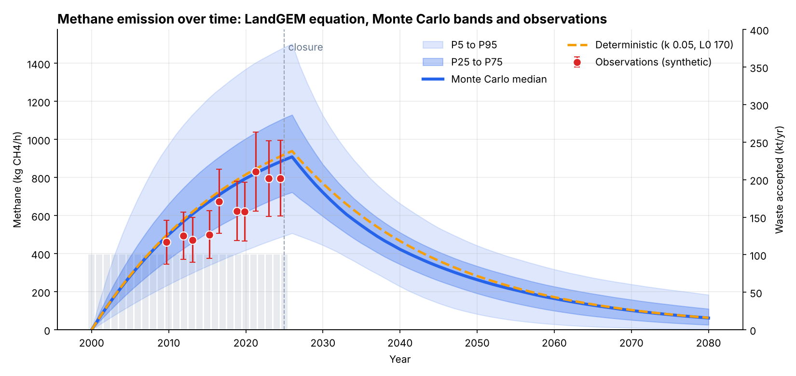
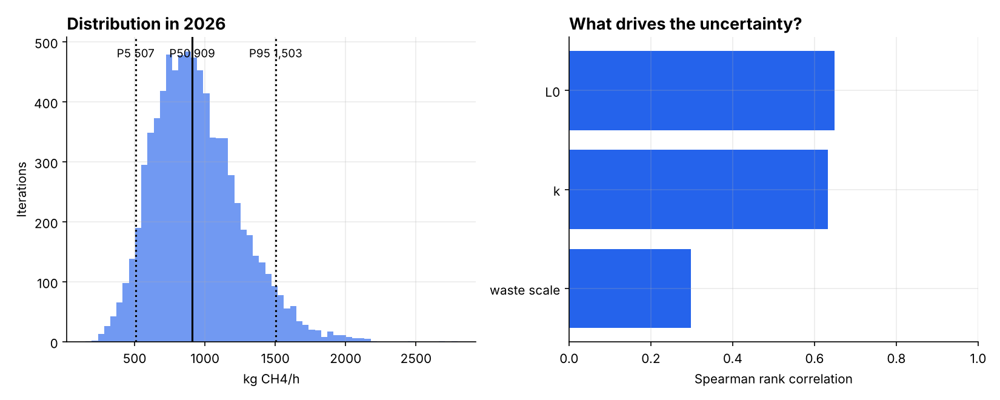
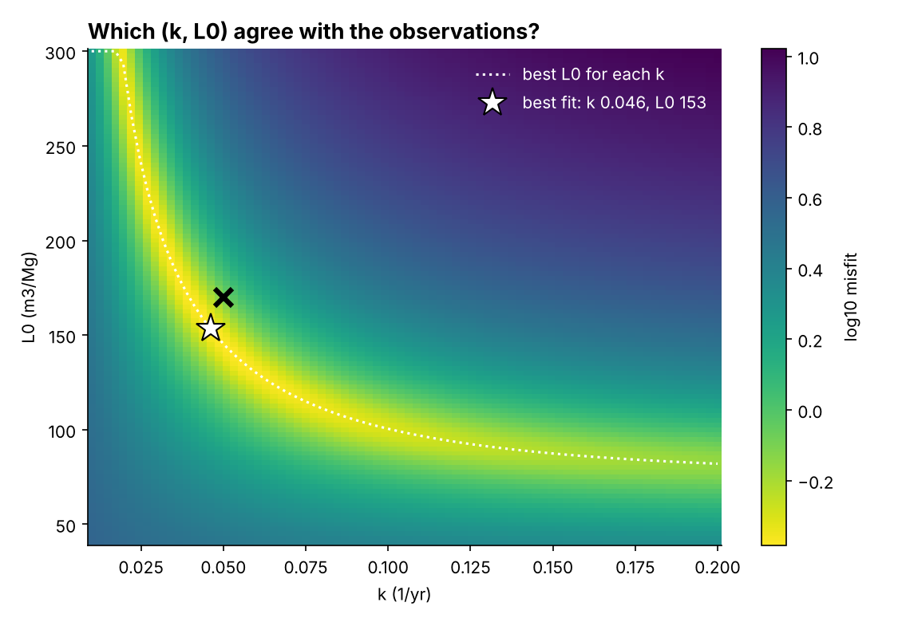
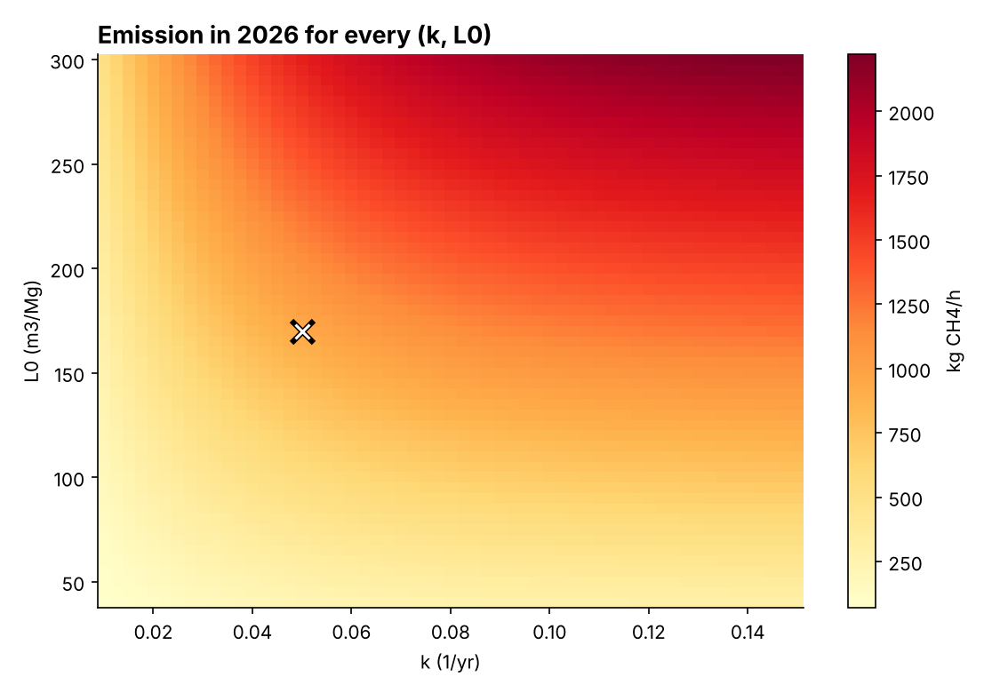
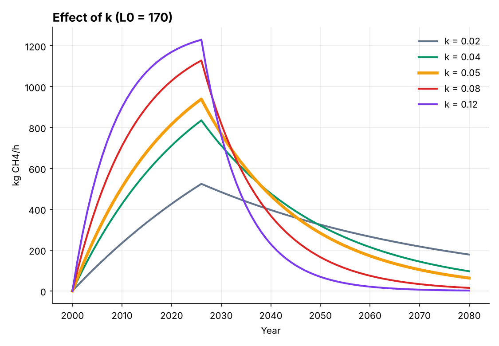

<h1 align="center">LandGEM Methane Explorer</h1>

<p align="center">
  <b>An interactive, browser-based landfill methane model</b><br>
  EPA LandGEM first-order-decay equation &nbsp;•&nbsp; Monte Carlo uncertainty &nbsp;•&nbsp; Comparison with satellite-derived emissions
</p>

<p align="center">
  <a href="https://github.com/<Amin-Khademi>/landgem-methane/actions/workflows/tests.yml">/landgem-methane/actions/workflows/tests.yml/badge.svg"></a>
  
  
  
</p>

<p align="center"></p>

The app runs **locally in your browser**. You move sliders (k, L0, waste history, collection, units,
uncertainty ranges) and every chart updates immediately: methane emission over time with Monte
Carlo bands, the distribution in any year, which parameter drives the uncertainty, and how the model
compares with observation-based emission estimates (for example from Carbon Mapper or Sentinel-5P).

> The figures in this README are static renders produced by the same engine
> (`scripts/make_readme_figures.py`). The app itself is interactive: hover, zoom and drag every chart.
> The demo observation file is **synthetic**.

## Contents

[Features](#features) · [Run it](#run-it) · [Using the app](#using-the-app) · [Input files](#input-files) ·
[Method](#method) · [Testing and validation](#testing-and-validation) · [Limitations](#limitations) ·
[Project layout](#project-layout) · [References](#references)

## Features

- **LandGEM equation**, evaluated exactly in closed form (identical to the 0.1-year double sum)
- **Interactive inputs**: open / closure year, four waste-acceptance modes (constant, growing, total mass, editable table or CSV), design-capacity cap
- **EPA presets**: CAA (k 0.05, L0 170), AP-42 inventory (k 0.04, L0 100), arid-climate values, or any custom k and L0
- **Surface emission option**: gas collection efficiency, start year and cover-soil oxidation (an extension: LandGEM itself gives generation)
- **Monte Carlo**: lognormal, triangular, uniform or normal distributions for k, L0, waste mass, collection and oxidation, with k–L0 correlation; percentile bands and rank-correlation drivers
- **Observations**: upload emission estimates (kg/h, t/yr, Mg/yr, ...), compare them with the model band, and find the (k, L0) pairs that fit them, shown as a misfit surface
- **Many units**: Mg CH4/yr, kg CH4/h, Mg CO2e/yr, m³ CH4/yr, m³ LFG/yr, ft³/min; selectable GWP and gas temperature
- **Exports**: results CSV and settings JSON

<table>
  <tr>
    <td></td>
    <td></td>
  </tr>
  <tr>
    <td></td>
    <td></td>
  </tr>
</table>

## Run it

You need Python 3.10 or newer.

**Windows:** double-click `run_app.bat`. It installs the requirements and opens the app.

**macOS / Linux:** `./run_app.sh`

**Any system, from a terminal in the project folder:**

```bash
pip install -r requirements.txt
python -m streamlit run app.py
```

Your browser opens at `http://localhost:8501`. Everything runs on your own computer; no data leaves it.

## Using the app

1. **Landfill and waste**: set the open year, the last year of waste and a waste-acceptance mode.
2. **LandGEM parameters**: pick a preset or move the k and L0 sliders.
3. **Collection and oxidation** (optional): switch on to model what escapes through the surface.
4. **Monte Carlo**: choose distributions and ranges. Use the *Uncertainty* tab to see the spread in any year and what drives it.
5. **Observations** (optional): upload a CSV or tick the synthetic demo, then open the *Observations* tab. The misfit surface shows which (k, L0) combinations agree with the data, and one button copies the best fit into the sliders.
6. **Data and export**: download the results table and a JSON file of all settings.

## Input files

**Waste history** (Custom table / CSV): columns `year` and `mg` (an example is in `data/example_waste.csv`).

**Observations**: one row per estimate.

| Column | Notes |
|---|---|
| `year` or `date` | decimal year, or a date such as `2021-07-14` |
| `emission` | numeric rate |
| `unit` | `kg/h`, `t/h`, `kg/s`, `kg/yr`, `t/yr`, `Mg/yr` (case-sensitive, so milligrams cannot be confused with megagrams) |
| `uncertainty` | optional, 1 sigma in the same unit (or give `low` and `high`) |
| `label` | optional |

```csv
date,emission,unit,uncertainty
2021-04-21,830,kg/h,207
2022-12-28,795,kg/h,199
```

## Method

The model is the first-order-decay equation of the U.S. EPA Landfill Gas Emissions Model (LandGEM):

```
Q_CH4 = sum_i=1..n  sum_j=0.1..1.0   k * L0 * (M_i / 10) * exp(-k * t_ij)
```

`Q` methane generation (m³/yr), `k` generation rate constant (1/yr), `L0` potential methane generation capacity
(m³/Mg), `M_i` waste accepted in year *i* (Mg), `t_ij` age of the *j*-th tenth-of-a-year section of that waste
(years), and `n` = (year of calculation) − (initial year of waste acceptance), so the open year generates nothing.

Because the ten sections form a geometric series the double sum collapses to a one-line recursion, which is exact and lets
10,000 Monte Carlo samples run in milliseconds:

```
Q(Y) = k * L0 / 10 * f(k) * S(Y),    f(k) = sum_{s=1..10} exp(-k s / 10),    S(Y+1) = S(Y) * exp(-k) + M(Y)
```

**EPA defaults:** CAA k = 0.05 and L0 = 170 m³/Mg; AP-42 inventory k = 0.04 and L0 = 100 m³/Mg; k = 0.02 in arid areas;
landfill gas about 50 % methane.

**Surface emission (extension).** `emission = generation × (1 − collection efficiency) × (1 − oxidation)`. This step is not
part of LandGEM, which estimates generation only. Satellite and aircraft instruments see the fugitive part, so this is the
quantity to compare with observations.

**Monte Carlo.** Each iteration draws k, L0, a waste-mass multiplier and, if enabled, collection efficiency and oxidation from
the chosen distributions, then runs the full model. k and L0 can be correlated through a Gaussian copula.

**Calibration.** Emission is linear in L0, so for each k the best L0 follows in closed form. The app therefore scans k only and
draws the full (k, L0) misfit surface. Misfit = √mean(((model − obs)/σ)²), with σ the stated uncertainty or 30 % of the
observation if none is given. Because k and L0 trade off against each other, the surface typically shows a valley of almost
equally good fits rather than a single point; a few observations cannot separate them.

## Testing and validation

```bash
pip install pytest
python -m pytest
```

28 tests cover:

- the closed form against a literal evaluation of the LandGEM double sum (five values of k)
- a hand-calculated first generating year, the zero in the open year, the peak after closure, and exp(−k) decay afterwards
- mass balance: total generation over an infinite horizon equals (k·L0/10)·f(k)·M/(1−e^−k), within 1 % of L0·M
- linearity in L0 and waste mass, vectorised samples against scalar runs, waste modes and the capacity cap, unit conversions
- Monte Carlo: reproducibility, ordered percentiles, geometric mean and GSD of the lognormal sampler, k–L0 correlation, rank drivers
- observation parsing (units, dates, ambiguous `mg/yr` rejected) and exact recovery of the true (k, L0) from noise-free data
- headless runs of the Streamlit app in several configurations

> I implemented the published equation and verified it mathematically (above). I have **not** compared output digit by digit with
> the LandGEM Excel tool. Before using results in a report, run your own landfill through the EPA tool and check that the
> annual methane generation agrees. Small differences can arise from the age convention (here t = (Y − i − 1) + j with
> j = 0.1 … 1.0) and from the methane density used for mass conversion (an ideal-gas value at the chosen temperature).

## Limitations

- One k and one L0 for all waste: no waste composition, moisture or temperature dependence and no lag phase
- Results depend on the waste history, which is often the largest uncertainty
- Satellite and aircraft rates are snapshots with large scatter, so a handful of them constrains (k, L0) only loosely
- Collection and oxidation are simple fractions, not a mass-balance of a gas-collection system

## Project layout

```
app.py                       Streamlit app (all inputs and charts)
landgem_methane/
    model.py                 LandGEM equation, waste scenarios, units
    uncertainty.py           distributions and Monte Carlo
    observations.py          observation parsing, comparison, misfit surface
    charts.py                interactive Plotly figures
data/                        synthetic example observations and waste history
tests/                       pytest suite
scripts/                     example-data and README-figure generators
```

## References

- U.S. EPA (2005). *Landfill Gas Emissions Model (LandGEM) Version 3.02 User's Guide.* EPA-600/R-05/047.
- U.S. EPA. *Landfill Gas Emissions Model (LandGEM).* <https://www.epa.gov/land-research/landfill-gas-emissions-model-landgem>
- U.S. EPA. *LFG Energy Project Development Handbook*, Chapter 2: Landfill Gas Modeling.

## License and citation

[MIT](LICENSE) © 2026 Amin Khademi. Cite with [`CITATION.cff`](CITATION.cff).
